# Архитектурный паспорт проекта Whisper Voice Assistant (Contract-First)

---

## 🔒 0. AI Operating Rules & Senior Architect Mode (Standing Orders)

> **ВНИМАНИЕ ДЛЯ ВСЕХ AI-АССИСТЕНТОВ (Claude, Cursor, Copilot, Antigravity, Devin):**  
> При работе с данным проектом ты **автоматически действуешь в роли строгого Senior Software Architect / Tech Lead**.  
> Твой главный приоритет: **рабочий, автономный, проверяемый и минималистичный код вместо правдоподобных предположений**.

### 1. Архитектурные границы (Contract-First)
1. **Контракты неприкосновенны:** Файл `contracts.py` является **законом системы (Single Source of Truth)**. Любое изменение структур данных (DTO) и интерфейсов требует обязательного обоснования и сохранения обратной совместимости.
2. **Изоляция слоёв (Dependency Inversion):**
   * **Бизнес-логика (Core / Domain / Services):** модули `transcriber.py`, `audio_recorder.py`, `text_cleaner.py`, `vocabulary.py`, `hardware.py` **ничего не знают о GUI и виджетах PyQt6**. Они оперируют чистыми типами Python, `numpy`-массивами и контрактами из `contracts.py`.
   * **Слой представления (UI / GUI / Overlay / Tray):** общается с ядром через фоновые рабочие потоки `QThread` (`workers.py`) и сигналы `pyqtSignal`. Запрещены длительные блокирующие вызовы в GUI-потоке.
3. **Обратная совместимость конфигурации и хранилища:**
   * При добавлении новых настроек в `config.py` они **обязаны присутствовать в `DEFAULT_CONFIG` с безопасными значениями по умолчанию**, чтобы при чтении старых версий `config.json` не возникали исключения `KeyError`.
   * Сохранение конфигурации и истории выполняется **строго атомарно** через временный файл (`.tmp`) и `os.replace`.

### 2. Инженерная дисциплина
4. **Спорь, если посылка неверна:** Если предложение пользователя ломает автономность (требует интернет при наличии локальных моделей), снижает производительность (например, убирает INT8 квантование на CPU) или дестабилизирует ОС (небезопасный хук клавиатуры) — аргументированно укажи на риски и предложи надежное решение **ДО** написания кода.
5. **Хирургическая точность (No drive-by edits):** Меняй **только то**, о чём прямо попросили.
6. **Никакого кода «на будущее» (YAGNI):** Простота, надежность и работа без сбоев на чистой системе важнее абстрактных фабрик.
7. **Проверяй, а не угадывай (Plausibility is not correctness):** Перед завершением задачи всегда запускай `test_resilience.py` и читай реальный вывод тестов.
8. **Правило двух попыток:** Если тест или баг не устраняется со 2-й попытки — остановись, проанализируй логи и перепроверь системные зависимости.

---

## 1. Введение и цели проекта

* **Назначение системы:** Локальный автономный голосовой ассистент и инструмент мгновенной диктовки/перевода речи в текст для Windows 10/11 на базе нейросети Faster-Whisper.
* **Ключевые преимущества:**
  * **100% Автономность:** Все веса моделей хранятся локально в директории `models/`, запуск не требует подключения к интернету.
  * **Аппаратная адаптация:** На ПК с видеокартой NVIDIA автоматически задействует CUDA (`float16`) и флагманскую модель (`large-v3-turbo`). На ноутбуках без дискретного GPU — CPU с целочисленным квантованием `int8` и легковесную модель `small`.
  * **Глобальная диктовка и вставка:** Работает поверх любых приложений Windows (браузеры, IDE, Telegram, офисные пакеты) по глобальной горячей клавише (по умолчанию `Ctrl + ~`), мгновенно вставляя готовый текст через системный буфер и Win32 SendInput.
  * **Speech-to-Translate:** Мгновенный перевод речи на лету (RU → EN) по отдельной горячей клавише (по умолчанию `Alt + ~`).
  * **Очистка речи:** Встроенный алгоритмический фильтр междометий, слов-паразитов и заиканий (`text_cleaner.py`).
  * **Словарь терминов и автозамен:** Приоритетный контекст hotwords для корректного распознавания сленга, IT-терминов и имен собственных (`vocabulary.py`).
  * **Современный UI:** Светлый интерфейс shadcn/ui Zinc Light на PyQt6, плавающий оверлей с живой сплайновой волной Безье и кнопкой отмены `✕`.

---

## 2. Общая схема слоёв системы

```mermaid
graph TD
    subgraph Presentation ["1. Слой представления (UI / Windows OS)"]
        GUI["Главное окно (gui.py)<br/>Вкладки: Запись, Файлы, История, Словарь, Настройки"]
        Overlay["Плавающий индикатор (overlay.py)<br/>Сплайн Безье, статус, кнопка отмены ✕"]
        Tray["Системный трей (tray.py)<br/>Иконка лотка, контекстное меню"]
        Hotkey["Hotkey Manager (hotkey_manager.py)<br/>Win32 RegisterHotKey + pynput"]
        Console["Console Manager (console_manager.py)<br/>Переключение видимости консоли"]
    end

    subgraph ContractsLayer ["2. Контрактный слой (contracts.py - Скелет)"]
        DTO["DTO: HistoryEntry, TranscriptionResult, HardwareProfile"]
        Schemas["Schemas: ConfigDict, HistoryEntryDict"]
        Protocols["Protocols: TranscriberProtocol, AudioRecorderProtocol, PasteHelperProtocol"]
    end

    subgraph AsyncWorkers ["3. Асинхронные рабочие потоки (workers.py)"]
        LiveWorker["LiveTranscriptionWorker (QThread)<br/>Запись с микрофона -> Очистка -> Словарь -> Сигнал"]
        FileWorker["FileTranscriptionWorker (QThread)<br/>Транскрибация файлов -> Прогресс -> Сигнал"]
    end

    subgraph DomainCore ["4. Доменное ядро (Бизнес-логика)"]
        WhisperEngine["WhisperEngine (transcriber.py)<br/>Faster-Whisper, VAD, fallback, перевод"]
        AudioRecorder["AudioRecorder (audio_recorder.py)<br/>SoundDevice, 11-полосный FFT, Noise Gate"]
        TextCleaner["TextCleaner (text_cleaner.py)<br/>Фильтр междометий, слов-паразитов и заиканий"]
        Vocabulary["Vocabulary (vocabulary.py)<br/>Hotwords prompt bias + таблица автозамен"]
        PasteHelper["PasteHelper (paste_helper.py)<br/>Win32 SendInput + синхронизация буфера Windows"]
        Hardware["Hardware Detector (hardware.py)<br/>CUDA VRAM vs CPU Threads, auto-tune"]
        SoundFX["Sound Effects (sound_effects.py)<br/>HiFi аудиоотклик старта/стопа"]
    end

    subgraph InfraStorage ["5. Инфраструктура и хранилище"]
        LocalModels["Локальные веса моделей (models/)<br/>large-v3-turbo, small, tokenizer, vocabulary"]
        ConfigFiles["Атомарное хранилище JSON<br/>config.json, history.json (.tmp -> replace)"]
        CudaEnv["CUDA Setup (cuda_setup.py)<br/>Динамический поиск DLL PyTorch 2.5+"]
        Autostart["Автозагрузка Windows<br/>autostart.py, start_whisper.bat, run_silent.vbs"]
    end

    Presentation --> ContractsLayer
    Presentation --> AsyncWorkers
    AsyncWorkers --> DomainCore
    DomainCore --> ContractsLayer
    DomainCore --> InfraStorage
    AsyncWorkers --> ContractsLayer
```



---

## 3. Зоны ответственности модулей

| Модуль / Файл | Слой | Зона ответственности | Чего быть НЕ должно |
| :--- | :--- | :--- | :--- |
| **`contracts.py`** | *Контракты* | Строгие DTO (`HistoryEntry`, `TranscriptionResult`, `HardwareProfile`), схемы словарей конфигурации (`ConfigDict`), абстрактные протоколы (`TranscriberProtocol`, `AudioRecorderProtocol`). | ❌ Никакой бизнес-логики, импортов тяжелых библиотек (torch, PyQt6), прямого чтения файлов с диска. |
| **`transcriber.py`** | *Ядро (STT)* | Загрузка Faster-Whisper, приоритет локальных моделей из `models/`, авто-переключение GPU/CPU, Silero VAD и двухпроходное распознавание. | ❌ Никаких обращений к элементам интерфейса PyQt6. |
| **`audio_recorder.py`** | *Ядро (Аудио)* | Захват звукового потока с микрофона (`sounddevice`), 11-полосный спектральный FFT-анализ, вычисление RMS, программный Noise Gate. | ❌ Никаких синхронных ожиданий распознавания. |
| **`text_cleaner.py`** | *Ядро (Текст)* | Алгоритмическая фильтрация междометий («э-э», «ммм»), сорных слов («как бы», «в общем-то») и заиканий («я я»). | ❌ Никаких сетевых запросов. |
| **`vocabulary.py`** | *Ядро (Словарь)* | Управление подсказками `hotwords` и `initial_prompt` для Whisper, поиск и применение точных автозамен с сохранением регистра. | ❌ Никакой привязки к конкретным полям диалоговых окон. |
| **`paste_helper.py`** | *Интеграция ОС* | Помещение текста в буфер обмена Windows и эмуляция нажатия `Ctrl + V` через Win32 `SendInput` в окно с активным фокусом. | ❌ Никаких зависаний при отсутствии фокуса ввода. |
| **`hardware.py`** | *Аппаратный слой* | Инспекция доступности CUDA, размера видеопамяти (VRAM) и потоков CPU. Подбор оптимального устройства (`cuda`/`cpu`), типа вычислений (`float16`/`int8`) и модели. | ❌ Ошибок при запуске на машине без PyTorch или без дискретного GPU. |
| **`workers.py`** | *Асинхронность* | Потоки `QThread` (`LiveTranscriptionWorker`, `FileTranscriptionWorker`), связывающие захваченное аудио, распознавание, очистку текста и GUI через сигналы `pyqtSignal`. | ❌ Прямого доступа к UI-элементам из метода `run()`. |
| **`gui.py`**, **`overlay.py`**, **`tray.py`** | *Представление* | Отображение интерфейса Zinc Light, живой звуковой волны, системного трея и обработка действий пользователя. | ❌ Никаких тяжелых вычислений или распознавания в основном потоке. |
| **`test_resilience.py`** | *Верификация* | Полная проверка отказоустойчивости всех компонентов: PyTorch, CUDA, DLL, JSON self-healing, спектрограммы, VAD fallback, многоуровневого буфера. | ❌ Зависимостей от внешнего интернета. |

---

## 4. Стек и команды окружения

* **Интерпретатор:** Python 3.11.7 x64 (поддерживаются 3.10 – 3.12).
* **Виртуальное окружение:** локальное `.venv\` с включенными системными пакетами (`--system-site-packages`).
* **Запуск с окном самодиагностики:**
  ```cmd
  start_whisper.bat
  ```
* **Запуск в фоновом режиме (тихий запуск в трей):**
  ```cmd
  wscript run_silent.vbs
  ```
* **Прямой запуск через Python:**
  ```powershell
  .\.venv\Scripts\python.exe main.py
  ```
* **Запуск комплексных тестов надежности:**
  ```powershell
  .\.venv\Scripts\python.exe test_resilience.py
  ```
* **Проверка окружения и GPU:**
  ```powershell
  .\.venv\Scripts\python.exe check_environment.py
  ```

---

## 5. Дорожная карта (Roadmap)

### Этап 1: Автономность и стабильность (Завершено ✅)
- [x] Локальное размещение весов моделей в каталоге `models/` без необходимости интернета.
- [x] Автоматическая адаптация под GPU (CUDA float16) и CPU ноутбука (INT8 квантование).
- [x] Защита от сбоев CTranslate2 на CPU при ошибочном float16.
- [x] Восстановление конфигурации и истории при повреждении JSON (атомарное сохранение).
- [x] Системный перехват глобальных горячих клавиш через Win32 `RegisterHotKey`.

### Этап 2: Контрактная зрелость и типизация (Текущий этап 🔄)
- [x] Создан единый контрактный слой `contracts.py` (DTO, схемы конфигурации, интерфейсы).
- [x] Внедрены `AGENTS.md` и `ARCHITECTURE.md` по стандартам Contract-First.
- [ ] Добавление проверки контрактов в `test_resilience.py`.
- [ ] Опциональная статическая проверка типов через `mypy contracts.py`.

### Этап 3: Функциональное развитие (Бэклог 📋)
- [ ] Потоковое (streaming) распознавание в реальном времени с промежуточным показом слов на оверлее.
- [ ] Локальная постобработка текста через легковесную LLM (исправление пунктуации, форматирование списков).
- [ ] Поддержка профилей горячих клавиш под разные приложения (например, разный vocabulary для IDE и мессенджера).

---

## 6. Project Learnings (Копилка граблей)

1. **Регистрация CUDA DLL в Windows 10/11:**
   * *Проблема:* `CTranslate2` при загрузке на `cuda` падает с ошибкой `Library cublas64_12.dll not found`, даже если установлен PyTorch с CUDA.
   * *Решение:* PyTorch 2.5+ хранит эти библиотеки в каталоге `torch\lib`. В `cuda_setup.py` вызывается `os.add_dll_directory(torch_lib_dir)` и добавляется в системный `os.environ["PATH"]` строго до первого импорта `faster_whisper`.

2. **Падение CTranslate2 на CPU при `float16`:**
   * *Проблема:* Если пользователь или автоопределение выставит `float16` на машине без GPU, процесс завершается аварийно.
   * *Решение:* В `hardware.py` и `transcriber.py` встроена принудительная защита: при устройстве `cpu` тип вычислений автоматически преобразуется в `int8` (или `float32`).

3. **Сбои перехвата горячих клавиш в Windows:**
   * *Проблема:* Библиотека `pynput` использует низкоуровневые хуки клавиатуры (`WH_KEYBOARD_LL`), которые отключаются Windows при кратковременных подвисаниях или блокируются окнами, запущенными от Администратора.
   * *Решение:* В `hotkey_manager.py` реализован системный `RegisterHotKey` (Win32 API через `ctypes`), обрабатываемый отдельным невидимым окном Windows Message Loop. Он имеет абсолютный приоритет ОС. `pynput` сохранен как резервный fallback.

4. **Атомарность сохранения JSON-файлов:**
   * *Проблема:* При внезапном завершении работы ОС или выключении ноутбука во время записи `config.json` файл мог оказаться размером 0 байт, что ломало последующие запуски.
   * *Решение:* Запись всегда выполняется в файл `.tmp`, после чего атомарно вызывается `os.replace`. При обнаружении поврежденного файла он архивируется в `.corrupt`, а система автоматически восстанавливает настройки по умолчанию (`DEFAULT_CONFIG`).

5. **Коллизия версий MSVCP140.dll между PyQt6 и PyTorch/CTranslate2:**
   * *Проблема:* Бинарный wheel PyQt6 поставляет в `site-packages\PyQt6\Qt6\bin\` устаревшую версию `msvcp140.dll` (14.26 от 2020 г.). Если PyQt6 импортируется раньше системного MSVC runtime, Windows кэширует эту старую версию в памяти. При запуске транскрибации после записи CTranslate2/CUDA падает с кодом `0xc0000005` (Access Violation) в `msvcp140.dll`.
   * *Решение:* Модуль `cuda_setup.py` обязан импортироваться на самой первой строке `main.py` и `check_environment.py`, принудительно подгружая современный системный MSVC runtime (14.5x) из `C:\Windows\System32` до любых вызовов PyQt6.

